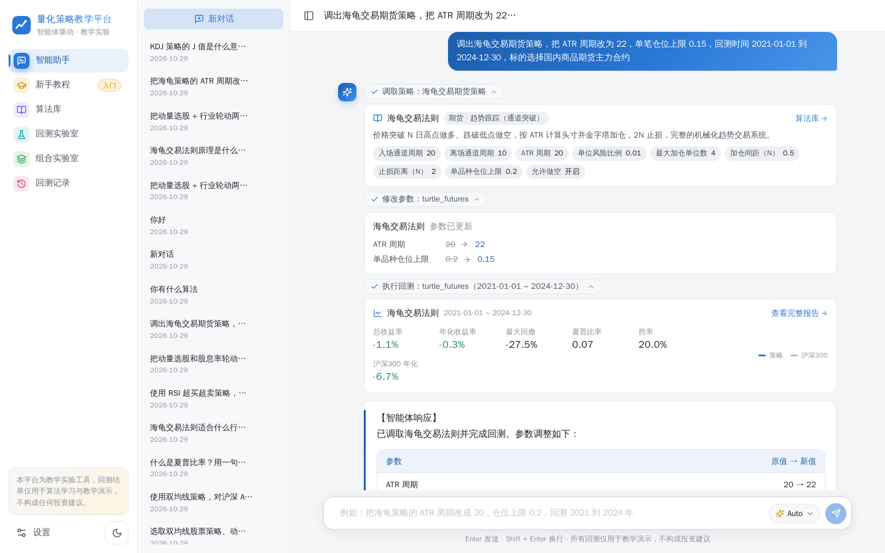
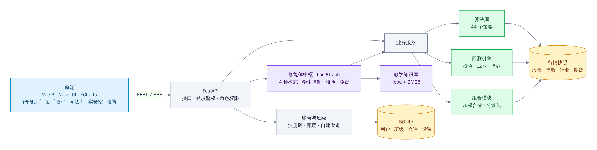
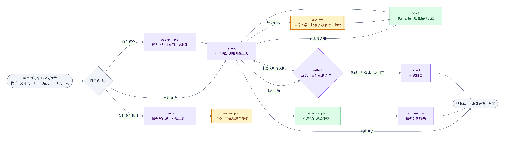
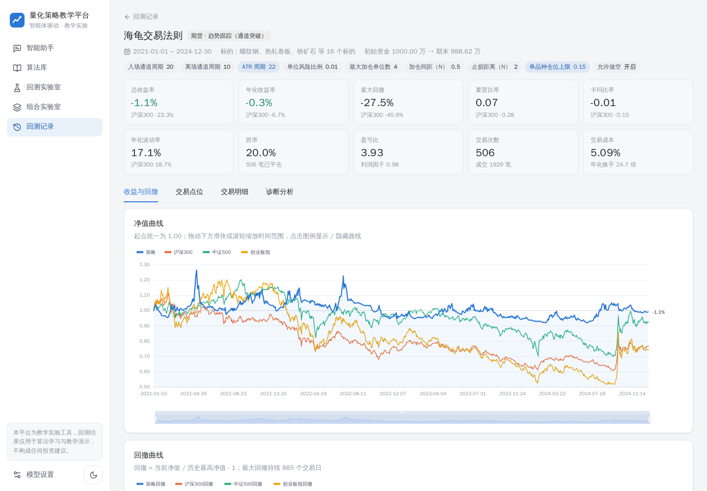
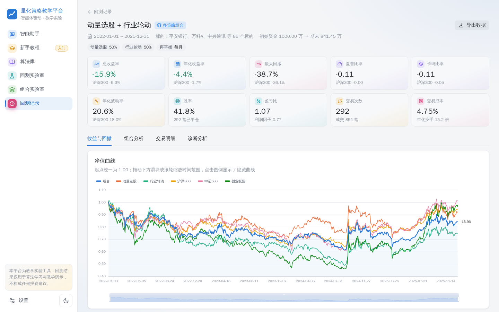
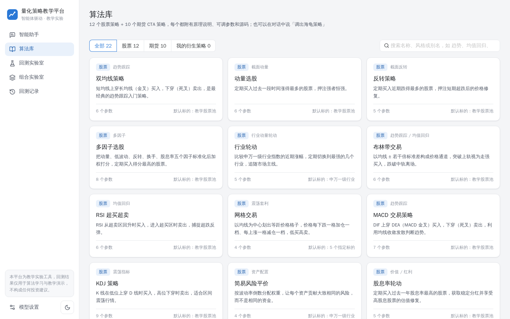
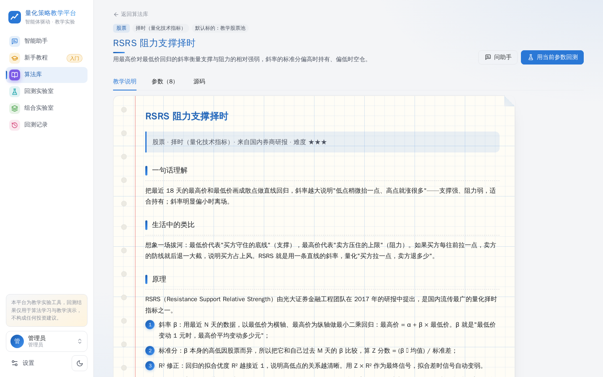
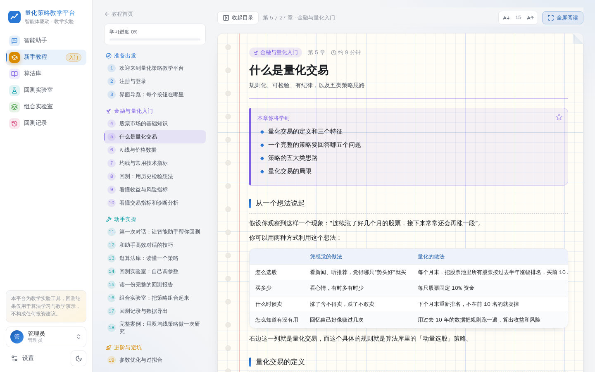
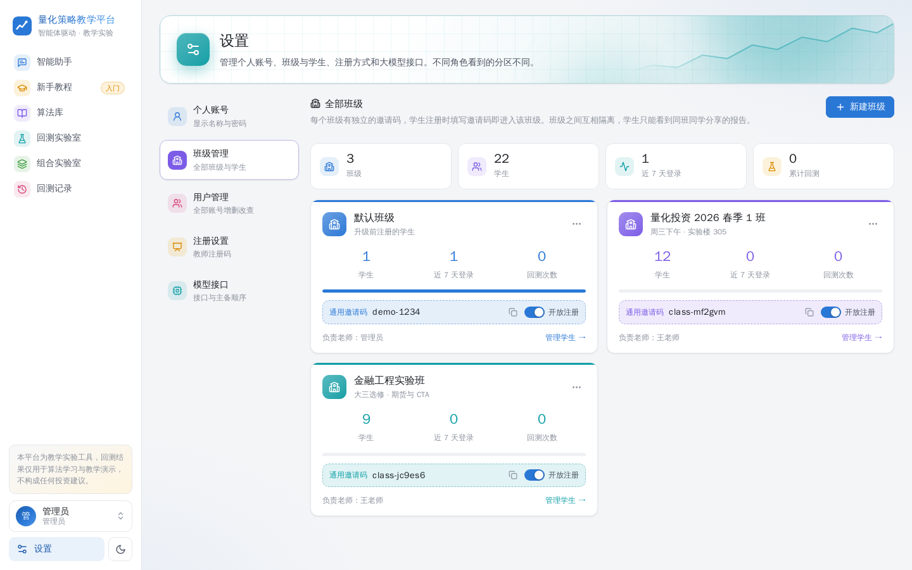

# 面向教学的智能体驱动量化算法策略平台

一个面向教学场景的量化策略实验平台：以大模型智能体为交互中枢，学习者用自然语言调取内置的 **44 种**股票、期货经典量化算法，修改参数、指定区间回测，查看收益曲线与沪深 300、中证 500、创业板指的对比和全套量化指标；智能体基于真实回测数据解读报告、给出附带原理说明的参数优化建议，并支持多策略组合回测与分散化分析。

> ⚠️ **免责声明**：本平台是教学实验工具，所有回测结果仅用于算法学习和策略教学演示。历史回测不代表未来表现，不构成任何投资建议。

赛题来源：深圳海知科技有限公司，原文见 [`赛题文档 -深圳海知科技有限公司.docx`](./赛题文档%20-深圳海知科技有限公司.docx)。



## 功能亮点

- **对话即操作**：「调出海龟交易期货策略，把 ATR 周期改为 22，仓位上限 0.15，回测 2021 到 2024 年」——智能体依次调取策略、修改参数（展示原值 → 新值）、执行回测，界面实时显示每一步，并在右侧自动展开完整报告。
- **学生自主决策**：对话框旁的「智能体控制」可在四种模式间切换——**自动执行**、**每步确认**（工具调用前暂停，由学生批准、改参数或拒绝）、**先计划后执行**（智能体列计划，学生增删改步骤后由程序执行）、**自主研究**（智能体自己计划、实验、反思、迭代，交研究报告）；还能限定允许的工具、可用的策略范围和回测次数，由后端强制执行。整个流程用 **LangGraph** 编排。
- **不编造结果**：指标全部由自研回测引擎计算；回复中的每个百分数和小数都会与工具结果自动核验，显示「数据核验通过」。
- **可解释的优化建议**：每条建议包含"问题（附数据证据）→ 具体参数调整 → 预期方向 → 原理"，并可调用参数对比实验实际验证。
- **严谨的回测引擎**：次日开盘成交（无未来函数）、A 股 100 股一手、佣金与按日期变化的印花税、涨跌停不可成交、期货逐日盯市与保证金上限、按持仓量自建主力连续合约并计入换月成本。
- **完整数据集**：报告一键导出 CSV（每日净值、量化指标、每笔交易、逐笔成交、逐日持仓），Excel 直接打开；点击净值曲线上的任意一天即可查看当日持仓。
- **多策略组合**：等权或自定义权重、月 / 季再平衡，输出相关系数矩阵、分散化比率和风险贡献。
- **零基础新手教程**：侧边栏「新手教程」是一本 27 章的格子纸笔记（配实际界面截图、两个真实数据案例、每章自测题），支持收起目录、调节字号、全屏沉浸阅读，图片可点开缩放，分「准备出发 / 金融与量化入门 / 动手实操 / 进阶与避坑」四部分，从什么是量化讲到熟练使用整个平台；每章附「动手试试」直达对应页面，可标记学完、显示学习进度。
- **教学辅助**：每个算法都有原理、交易规则、参数影响、适用场景、局限和调参思路；知识库讲解指标含义和回测陷阱（未来函数、过拟合、幸存者偏差……）。
- **强制免责与合规**：回测类回复由程序自动附加免责声明；寻求实盘买卖建议的提问会被识别并礼貌拒绝。
- **班级与账号**：可选开启登录，管理员 / 老师 / 学生三种角色。老师可创建多个班级，每个班级有独立邀请码，班级之间数据隔离；支持通用邀请码和一次性注册码、下载模板批量导入学生名单、重置密码、停用、移班；按每日对话次数分配模型额度，可单独开关平台模型权限，用户也可以添加只属于自己的模型渠道；班级卡片和详情页展示人数、活跃度与回测量。
- **模型自由配置**：页面上添加任意 OpenAI 兼容接口、一键拉取模型列表、测试工具调用能力；主模型失败时自动切换备用模型；对话输入框里（发送按钮左侧）可选 Auto 或按渠道指定任一模型。
- **舒适的界面**：浅色 / 深色主题，A 股红涨绿跌配色，图表配色通过色盲安全校验；教学说明和教程用笔记本格子纸排版，智能体回复的小节、要点标签（问题 / 调整 / 原理）、表格和提示框都有专门样式。

## 算法库（44 种）

赛题清单中的 22 种策略全部实现，并在此基础上扩充了 22 种业界或学术界有公开出处的经典策略（教学文档中注明了提出者、论文或研报出处）。所有策略都通过「截断数据前后信号一致」的无未来函数检验；CCI、RSRS、ADX、SAR、KAMA、TRIX 等指标与按原始定义逐日计算的独立实现逐位核对一致。

**股票策略（24）**

| 思路 | 赛题清单 | 扩充 |
|---|---|---|
| 趋势跟踪 | 双均线策略、MACD 交易策略、布林带交易 | 三均线多头排列、唐奇安通道突破、TRIX 三重指数平滑、CCI 顺势指标（Lambert）、RSRS 阻力支撑择时（光大证券）、OBV 能量潮（Granville） |
| 均值回归 / 震荡 | RSI 超买超卖、KDJ 策略、网格交易 | 威廉指标 %R（Larry Williams）、乖离率回归 |
| 截面选股 / 轮动 | 动量选股、反转策略、多因子选股、行业轮动、股息率轮动 | 52 周新高选股（George & Hwang）、低波动选股（低波动异象） |
| 资产配置 / 风险控制 | 简易风险平价 | 目标波动率择时（Moreira & Muir）、等权定期再平衡（1/N，DeMiguel 等） |

**期货 CTA 策略（20）**

| 思路 | 赛题清单 | 扩充 |
|---|---|---|
| 趋势跟踪 | 海龟交易法则、趋势跟踪 CTA、双均线期货策略、移动平均通道 | MACD 期货多空、DMI/ADX 趋势强度（Wilder）、抛物线 SAR（Wilder）、考夫曼自适应均线 KAMA |
| 通道 / 波动率突破 | ATR 通道突破、布林带期货策略、波动率突破（Dual Thrust） | 布林带收口突破（Bollinger Squeeze） |
| 均值回归 / 回调 | 均值回归、网格期货策略 | RSI(2) 趋势回调（Connors） |
| 截面多空 | — | 期货截面动量、期货短期反转、期限结构展期收益（Carry，Koijen 等） |
| 套利 | 跨期简单套利 | 跨品种价差套利（配对交易，Gatev 等） |

每个策略的原理、手算示例、交易规则、参数影响、适用行情与常见误区见 **[算法库说明](docs/算法库说明.md)**；44 个策略在同一区间的真实回测结果见 [测试报告](docs/测试报告.md) 第 4 节（有赚有亏，如实列出）。

## 快速开始

需要 [uv](https://docs.astral.sh/uv/)（Python 依赖管理）、Node.js 20+ 和 pnpm。行情数据快照已随仓库提供，无需联网下载。

**macOS / Linux**

```bash
cp .env.example .env   # 可选：填写默认大模型接口；也可以启动后在「设置 → 模型接口」页面添加
./start.sh             # 安装依赖 → 构建前端 → 启动服务
```

**Windows**：双击项目根目录的 `start.bat`，或在 PowerShell 中运行：

```powershell
copy .env.example .env   # 可选，同上
.\start.bat              # 服务就绪后会自动打开浏览器
```

打开 <http://127.0.0.1:8000>。部署到 Linux 服务器：`./deploy/deploy.sh root@服务器IP .env`（最小化安装，约 620 MB 磁盘、400 MB 内存，见部署说明）。开发模式、数据更新、常见问题见 **[部署说明](docs/部署说明.md)**。

试试这些说法：

- 调出海龟交易期货策略，把 ATR 周期改为 22，单笔仓位上限 0.15，回测 2021-01-01 到 2024-12-30，标的选择国内商品期货主力合约
- 选取双均线股票策略、动量选股策略，做等权组合，回测 2022-01-01 至 2025-06-30，对比沪深 300
- 给我讲下布林带股票策略原理，它的可调参数是什么
- 胜率为什么这么低？给我一个具体的参数优化建议，并实际验证一下效果

## 系统架构



- **前端**只负责展示和交互：对话、教程、算法库、实验室、报告、设置；
- **智能体中枢**是调度层，不直接做交易：理解自然语言 → 调用工具（调取策略、改参数、回测、组合、检索知识库）→ 基于工具返回的真实数据解读；由 LangGraph 编排，学生可以决定每一步由谁做主（见下图）；
- **量化核心**（算法库、回测引擎、组合模块、数据层）不依赖接口层，可以在 Python 中单独调用；
- **账号与班级**负责登录、角色、班级隔离、注册码和模型额度。



模块级架构图、数据流和每个设计决策的原因见 **[系统设计文档](docs/系统设计文档.md)**。

## 技术栈

| 层 | 技术 | 用途 |
|---|---|---|
| 后端语言与依赖 | Python 3.12 · uv | Python 量化生态最完整；uv 锁定依赖、一条命令建好环境 |
| 接口 | FastAPI · Uvicorn · SSE（sse-starlette） | REST 接口 + 流式对话，自动生成参数校验 |
| 数据处理 | pandas · NumPy · PyArrow（Parquet） | 宽表行情、向量化指标、行情快照存储 |
| 参数模型 | Pydantic v2 | 一个模型同时生成参数校验、中文报错、前端表单和智能体工具说明 |
| 存储 | SQLite · SQLModel | 用户、班级、会话、模型设置、衍生策略；回测结果 gzip 存档 |
| 大模型 | OpenAI 兼容接口（openai SDK） | 工具调用 + 流式输出，主备模型自动切换 |
| 智能体编排 | LangGraph（LangChain 生态） | 状态图编排四种工作模式；`interrupt()` 暂停等学生确认，`Command(resume)` 继续 |
| 知识检索 | jieba · rank-bm25 | 中文分词 + BM25 关键词检索（RAG） |
| 前端 | Vue 3 · TypeScript · Vite · Pinia · Vue Router | 单页应用 |
| 组件与图表 | Naive UI · ECharts · lucide 图标 | 表单、表格、净值 / 回撤 / K 线买卖点等金融图表 |
| 正文渲染 | markdown-it + cjk-friendly | 教学文档、教程与智能体回复的排版 |
| 测试 | pytest · Playwright（截图检查） | 161 项自动化测试 + 页面巡检 |
| 数据来源 | AkShare（新浪财经） | 只在更新行情快照时需要，运行平台不需要联网取数 |

## 目录结构

```
├── backend/
│   ├── quant/                    # 量化核心（不依赖接口层，可独立使用）
│   │   ├── data/                 # 标的目录、行情加载、期货主力连续合约构建
│   │   ├── strategies/           # 策略基类、指标、44 个策略（.py）及教学文档（.md）
│   │   ├── engine/               # 回测配置与成本、逐日撮合、持仓账本、量化指标
│   │   ├── portfolio/            # 多策略组合与分散化分析
│   │   └── backtest.py           # 回测编排：数据 → 策略 → 引擎 → 指标 → 基准 → 诊断
│   ├── agent/                    # 智能体：LangGraph 编排、学生控制、工具、模型路由、知识库
│   ├── api/                      # FastAPI 接口、业务服务、账号班级与额度、数据库
│   ├── scripts/                  # 下载行情、生成算法文档、生成测试报告
│   └── tests/                    # 引擎、策略、接口、智能体、账号权限的自动化测试
├── frontend/src/
│   ├── views/                    # 智能助手、新手教程、算法库、回测 / 组合实验室、回测记录、设置（个人账号、班级管理、用户管理、注册设置、模型接口）
│   ├── tutorial/                 # 新手教程正文（27 章 Markdown）与目录
│   └── components/               # 对话消息与卡片、回测报告与图表、参数表单
├── data/market/                  # 行情快照（随仓库提交，保证可复现）
├── docs/                         # 设计文档、算法库说明、部署说明、测试报告
├── deploy/                       # 服务器一键部署：打包上传、最小化安装、systemd、Nginx 示例
├── start.sh                      # 一键启动（macOS / Linux）
└── start.bat / start.ps1         # 一键启动（Windows）
```

## 界面

| 回测报告 | 组合分析 |
|---|---|
|  |  |
| **算法库（按思路筛选）** | **策略教学说明（笔记格子纸）** |
|  |  |
| **新手教程** | **班级管理** |
|  |  |

## 交付物

- [x] [平台系统设计文档](docs/系统设计文档.md)：架构图、算法库清单、模块划分
- [x] 源代码与[部署说明](docs/部署说明.md)（含新增算法指南）
- [x] [测试报告](docs/测试报告.md)：161 项自动化测试（含 44 个策略的无未来函数检验）、引擎交叉验证、12 组回测案例（含参数修改、参数敏感性、多策略组合）、44 个策略全量测试、性能与压测、11 组真实模型对话测试
- [x] [算法库说明文档](docs/算法库说明.md)：44 种策略的原理、手算示例与参数
- [ ] 5 分钟以内演示视频

## 数据说明

- A 股：沪深 300 中 55 只各行业龙头的前复权日线（2016 年起）与历史分红；取自当前成分股，存在幸存者偏差；
- 指数：沪深 300、中证 500、创业板指；31 个申万一级行业指数；
- 期货：16 个商品品种（黑色、有色、贵金属、农产品、能源化工），由单合约按持仓量自建主力连续合约（2020 年起）；
- 数据来源 AkShare（新浪财经），仅用于教学。
