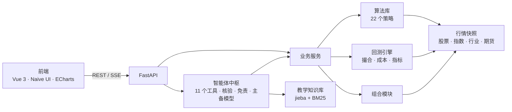
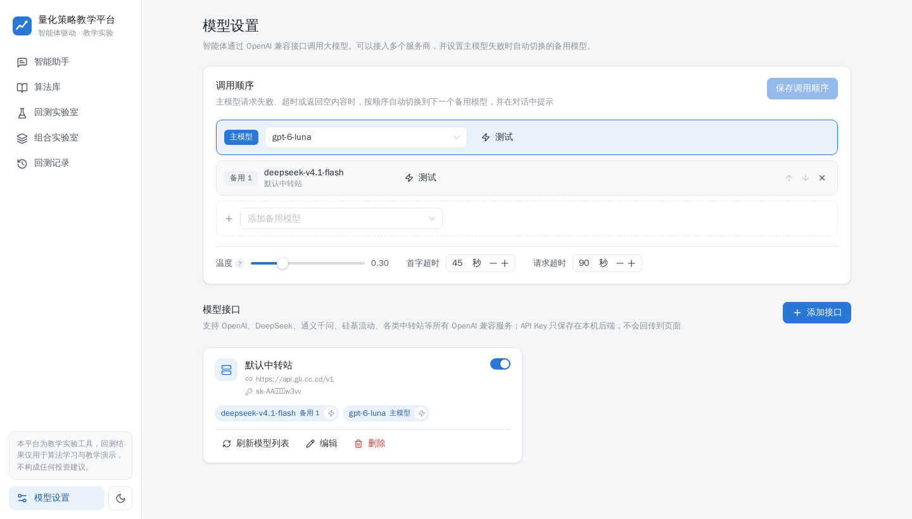

# 面向教学的智能体驱动量化算法策略平台

一个面向教学场景的量化策略实验平台：以大模型智能体为交互中枢，学习者用自然语言调取内置的 **22 种**股票、期货经典量化算法，修改参数、指定区间回测，查看收益曲线与沪深 300、中证 500、创业板指的对比和全套量化指标；智能体基于真实回测数据解读报告、给出附带原理说明的参数优化建议，并支持多策略组合回测与分散化分析。

> ⚠️ **免责声明**：本平台是教学实验工具，所有回测结果仅用于算法学习和策略教学演示。历史回测不代表未来表现，不构成任何投资建议。

赛题来源：深圳海知科技有限公司，原文见 [`赛题文档 -深圳海知科技有限公司.docx`](./赛题文档%20-深圳海知科技有限公司.docx)。


## 功能亮点

- **对话即操作**：「调出海龟交易期货策略，把 ATR 周期改为 22，仓位上限 0.15，回测 2021 到 2024 年」——智能体依次调取策略、修改参数（展示原值 → 新值）、执行回测，界面实时显示每一步，并在右侧自动展开完整报告。
- **不编造结果**：指标全部由自研回测引擎计算；回复中的每个百分数和小数都会与工具结果自动核验，显示「数据核验通过」。
- **可解释的优化建议**：每条建议包含"问题（附数据证据）→ 具体参数调整 → 预期方向 → 原理"，并可调用参数对比实验实际验证。
- **严谨的回测引擎**：次日开盘成交（无未来函数）、A 股 100 股一手、佣金与按日期变化的印花税、涨跌停不可成交、期货逐日盯市与保证金上限、按持仓量自建主力连续合约并计入换月成本。
- **完整数据集**：报告一键导出 CSV（每日净值、量化指标、每笔交易、逐笔成交、逐日持仓），Excel 直接打开；点击净值曲线上的任意一天即可查看当日持仓。
- **多策略组合**：等权或自定义权重、月 / 季再平衡，输出相关系数矩阵、分散化比率和风险贡献。
- **教学辅助**：每个算法都有原理、交易规则、参数影响、适用场景、局限和调参思路；知识库讲解指标含义和回测陷阱（未来函数、过拟合、幸存者偏差……）。
- **强制免责与合规**：回测类回复由程序自动附加免责声明；寻求实盘买卖建议的提问会被识别并礼貌拒绝。
- **模型自由配置**：页面上添加任意 OpenAI 兼容接口、一键拉取模型列表、测试工具调用能力；主模型失败时自动切换备用模型。
- **舒适的界面**：浅色 / 深色主题，A 股红涨绿跌配色，图表配色通过色盲安全校验。

## 算法库（22 种）

| 股票策略（12） | | 期货 CTA 策略（10） | |
|---|---|---|---|
| 双均线策略 | 布林带交易 | 海龟交易法则 | 布林带期货策略 |
| 动量选股 | RSI 超买超卖 | ATR 通道突破 | 波动率突破（Dual Thrust） |
| 反转策略 | 网格交易 | 跨期简单套利 | 移动平均通道 |
| 多因子选股 | MACD 交易策略 | 趋势跟踪 CTA | 网格期货策略 |
| 行业轮动 | KDJ 策略 | 均值回归 | 双均线期货策略 |
| 简易风险平价 | 股息率轮动 | | |

每个策略的原理与参数见 **[算法库说明](docs/算法库说明.md)**。

## 快速开始

需要 [uv](https://docs.astral.sh/uv/)（Python 依赖管理）、Node.js 20+ 和 pnpm。行情数据快照已随仓库提供，无需联网下载。

**macOS / Linux**

```bash
cp .env.example .env   # 可选：填写默认大模型接口；也可以启动后在「模型设置」页面添加
./start.sh             # 安装依赖 → 构建前端 → 启动服务
```

**Windows**：双击项目根目录的 `start.bat`，或在 PowerShell 中运行：

```powershell
copy .env.example .env   # 可选，同上
.\start.bat              # 服务就绪后会自动打开浏览器
```

打开 <http://127.0.0.1:8000>。部署到 Linux 服务器：`./deploy/deploy.sh root@服务器IP .env`（最小化安装，约 620 MB 磁盘、400 MB 内存，见部署说明）。开发模式、数据更新、常见问题见 **[部署说明](docs/部署说明.md)**。

试试这些说法：

- 调出海龟交易期货策略，把 ATR 周期改为 22，单笔仓位上限 0.15，回测 2021-01-01 到 2024-12-30，标的选择国内商品期货主力合约
- 选取双均线股票策略、动量选股策略，做等权组合，回测 2022-01-01 至 2025-06-30，对比沪深 300
- 给我讲下布林带股票策略原理，它的可调参数是什么
- 胜率为什么这么低？给我一个具体的参数优化建议，并实际验证一下效果

## 系统架构



详细设计见 **[系统设计文档](docs/系统设计文档.md)**。

## 目录结构

```
├── backend/
│   ├── quant/                    # 量化核心（不依赖接口层，可独立使用）
│   │   ├── data/                 # 标的目录、行情加载、期货主力连续合约构建
│   │   ├── strategies/           # 策略基类、指标、22 个策略（.py）及教学文档（.md）
│   │   ├── engine/               # 回测配置与成本、逐日撮合、持仓账本、量化指标
│   │   ├── portfolio/            # 多策略组合与分散化分析
│   │   └── backtest.py           # 回测编排：数据 → 策略 → 引擎 → 指标 → 基准 → 诊断
│   ├── agent/                    # 智能体：对话循环、工具、模型路由、知识库
│   ├── api/                      # FastAPI 接口、业务服务、数据库
│   ├── scripts/                  # 下载行情、生成算法文档、生成测试报告
│   └── tests/                    # 回测引擎单元测试
├── frontend/src/
│   ├── views/                    # 智能助手、算法库、回测 / 组合实验室、回测记录、模型设置
│   └── components/               # 对话消息与卡片、回测报告与图表、参数表单
├── data/market/                  # 行情快照（随仓库提交，保证可复现）
├── docs/                         # 设计文档、算法库说明、部署说明、测试报告
├── deploy/                       # 服务器一键部署：打包上传、最小化安装、systemd、Nginx 示例
├── start.sh                      # 一键启动（macOS / Linux）
└── start.bat / start.ps1         # 一键启动（Windows）
```

## 界面

| 回测报告 | 组合分析 |
|---|---|
|  |  |
| **算法库** | **模型设置** |
|  |  |

## 交付物

- [x] [平台系统设计文档](docs/系统设计文档.md)：架构图、算法库清单、模块划分
- [x] 源代码与[部署说明](docs/部署说明.md)（含新增算法指南）
- [x] [测试报告](docs/测试报告.md)：88 项自动化测试（含 22 个策略的无未来函数检验）、引擎交叉验证、10 组回测案例（含参数修改、参数敏感性、多策略组合）、22 个策略全量测试、性能与压测、11 组真实模型对话测试
- [x] [算法库说明文档](docs/算法库说明.md)：22 种策略的原理与参数
- [ ] 5 分钟以内演示视频

## 数据说明

- A 股：沪深 300 中 55 只各行业龙头的前复权日线（2016 年起）与历史分红；取自当前成分股，存在幸存者偏差；
- 指数：沪深 300、中证 500、创业板指；31 个申万一级行业指数；
- 期货：16 个商品品种（黑色、有色、贵金属、农产品、能源化工），由单合约按持仓量自建主力连续合约（2020 年起）；
- 数据来源 AkShare（新浪财经），仅用于教学。
