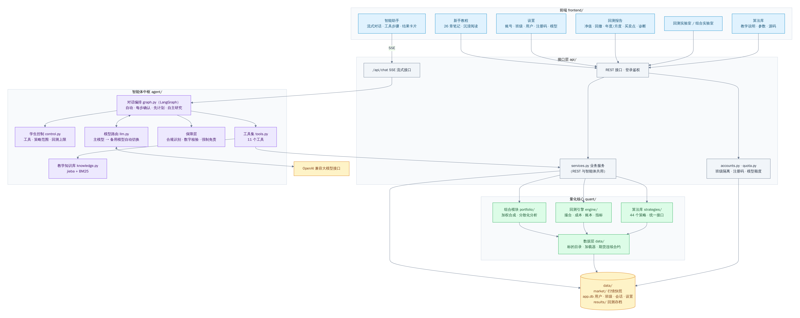
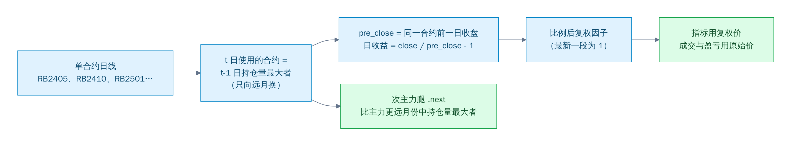
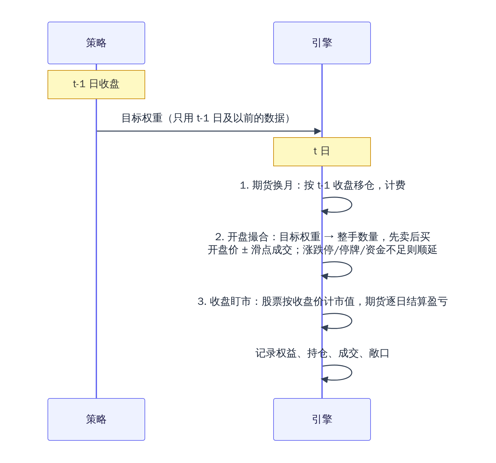
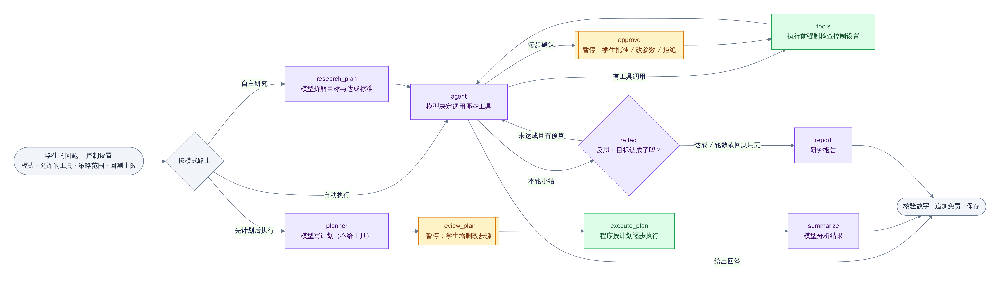
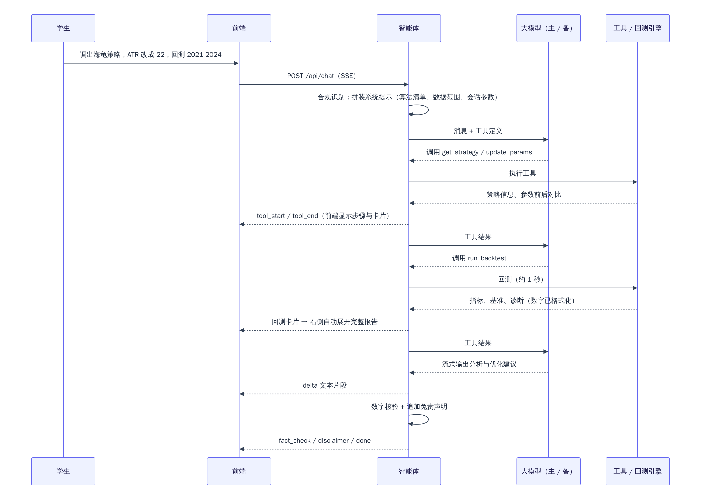

# 系统设计文档

> 面向教学的智能体驱动量化算法策略平台
> 本平台为教学实验工具，所有回测结果仅用于算法学习、策略教学演示，不构成任何投资建议。

## 1. 设计目标

| 目标 | 设计对策 |
|---|---|
| 学生用自然语言就能完成调取算法、改参数、回测、组合 | 大模型智能体作为调度层，通过 11 个工具调用平台能力；界面同时保留完整的点选操作 |
| 学生能自主决策，而不是一切交给智能体 | LangGraph 编排四种工作模式（自动执行、每步确认、先计划后执行、自主研究）；学生可限定工具、策略范围和回测次数，后端强制执行 |
| 回测结果可信、可复现 | 自研逐日撮合引擎，不依赖在线回测接口；行情快照随仓库提交；关键规则有单元测试和手工核对 |
| 智能体不编造结果、不给投资建议 | 指标由引擎计算后格式化给模型；回复中的数字自动核验；回测类回复由程序追加免责声明；识别并拒绝实盘建议类提问 |
| 面向教学 | 每个算法附原理、规则、参数影响、适用场景、局限和调参思路；参数敏感性实验让"为什么这样调"可以被验证 |
| 易扩展 | 策略统一接口 + 自动注册，新增一个策略只需写一个类和一篇文档；模块之间只通过数据结构交互 |

## 2. 总体架构



> 图的源文件在 `docs/diagrams/*.mmd`，修改后运行 `node docs/diagrams/render.mjs` 重新生成图片（GitHub 内置的 Mermaid 渲染会截断中文，所以提交渲染好的 PNG）。

**分层原则**：量化核心（`quant/`）不依赖接口层和智能体，可以单独在脚本或测试中使用；智能体只通过工具调用服务层，不直接接触回测细节；REST 接口与智能体工具共用 `services.py`，保证两条路径的结果完全一致。

### 2.1 目录与模块对应

| 模块 | 代码位置 | 职责 |
|---|---|---|
| 数据层 | `backend/quant/data/` | 标的目录（股票池、指数、期货规格）、行情加载、期货主力连续合约构建 |
| 算法库 | `backend/quant/strategies/` | 策略基类与注册、技术指标、公共工具、44 个策略及其教学文档、自然语言识别策略 |
| 回测引擎 | `backend/quant/engine/` | 回测配置与成本、逐日撮合、持仓账本、量化指标 |
| 回测编排 | `backend/quant/backtest.py` | 串起数据 → 策略 → 引擎 → 指标 → 基准对比 → 诊断 |
| 组合模块 | `backend/quant/portfolio/` | 多策略加权合成、再平衡、相关性与风险贡献 |
| 智能体 | `backend/agent/` | LangGraph 对话编排（graph.py）、学生控制（control.py）、工具、模型路由、知识库检索 |
| 接口层 | `backend/api/` | FastAPI 路由、业务服务、数据库、结果序列化 |
| 可视化 | `frontend/src/components/report/` | 净值、回撤、年度、月度、买卖点、相关性等图表与报告 |
| 前端页面 | `frontend/src/views/` | 智能助手、新手教程、算法库、回测 / 组合实验室、回测记录、模型设置 |
| 新手教程 | `frontend/src/tutorial/` | 27 章零基础教程（Markdown），打包进前端，无需后端接口 |

## 3. 数据层

### 3.1 数据来源与范围

全部来自 AkShare 的新浪财经接口（实测最稳定），由 `backend/scripts/download_data.py` 下载，汇总为 `data/market/` 下的 Parquet 快照并随仓库提交，回测时完全离线、可复现。

| 数据集 | 内容 | 范围 |
|---|---|---|
| `stock_daily` | 55 只股票前复权日线 + 不复权收盘价 + 换手率 | 2016-01 ~ 2026-10 |
| `dividends` | 55 只股票历史现金分红（除息日、每股派息） | 上市以来 |
| `index_daily` | 沪深 300、中证 500、创业板指 | 2016-01 ~ 2026-10 |
| `industry_daily` | 31 个申万一级行业指数 | 2016-01 ~ 2026-10 |
| `futures_continuous` | 16 个商品期货主力连续合约 + 次主力腿 | 2020-01 ~ 2026-10 |

**股票池**：沪深 300 中各行业的 55 只代表性龙头（覆盖 26 个申万一级行业）。因为取自当前成分股，存在**幸存者偏差**，股票策略的回测结果会偏乐观——这一点在教学文档和智能体知识库中都有说明。

### 3.2 期货主力连续合约

行情网站现成的"主力连续"把不同月份合约的价格直接拼接，换月日会出现新旧合约价差造成的跳空：用它算收益会把价差当作盈亏，趋势策略还会被跳空误触发。本平台用单合约数据自建：



- 用 **t-1 日** 的持仓量决定 t 日合约，不使用未来信息；
- 回测引擎在换月时按 t-1 日收盘价把持仓移到新合约，两条腿都收手续费和 1 跳滑点；
- 新浪只保留 2020 年及以后到期的合约，2019 年这些合约尚非真实主力，所以连续合约从 2020-01-01 开始。

### 3.3 两套价格

| 用途 | 股票 | 期货 |
|---|---|---|
| 技术指标（open/high/low/close） | 前复权价 | 比例后复权价 |
| 成交与盯市（exec_open/mark_close） | 不复权的真实价格（开盘价由"前复权开盘价 × 当日不复权收盘价 / 前复权收盘价"还原） | 当日实际合约的原始价格 |

股票的成交、整手、最低佣金、涨跌停都按真实价格计算，成交记录里的价格就是当天行情软件上能看到的价格。**分红送转**（`loader.corporate_actions`）：相邻两个交易日 p → t 之间，

- 现金分红 D = 除息日落在 (p, t] 内的每股派息之和（停牌期间除息的，复牌当天到账）；
- 送转比例 m = (raw_p × adj_t / adj_p − D) / raw_t，即复权收益扣掉现金分红后由股数增加解释的部分；偏离 1 不足 3% 视为价格取整误差，否则按 0.1 取整（10 送 3 → 1.3）；
- 除权参考价 = (raw_p − D) / m，用于判断除权日开盘是否涨跌停。

引擎在除权日开盘前把 D × 持股数记入现金、把持股数乘以 m，成交明细中以「分红」「送转」两类记录列出（不计入成交笔数和换手）。分红以现金持有，到下一次调仓时才重新投入，与真实账户一致；因此长期持有高股息股票时，结果会略低于"分红自动再投资"的复权收益。55 只股票 2016 年以来共识别出 65 次送转（如比亚迪 2025-07-29 的 10 送 20 派 39.74 元）。

## 4. 算法库

### 4.1 统一接口

```python
class Strategy(ABC):
    id, name, category, style, summary   # 元信息
    aliases                              # 自然语言别名："海龟""turtle"…
    Params: type[StrategyParams]         # pydantic 模型：默认值、范围、中文名、说明
    default_universe, asset_types, min_symbols
    def generate(self, bars: Bars) -> StrategyOutput  # 目标权重 + 调仓日 + 指标线
```

- **唯一职责**：根据截至 t 日收盘的行情给出 t 日收盘后的目标权重（名义市值 / 权益，期货可为负）。成交、成本、涨跌停、保证金、换月全部由引擎处理。
- **参数模型即说明书**：同一个 pydantic 模型自动生成参数校验（中文报错）、前端表单、智能体工具的参数说明和算法文档中的参数表。
- **自动注册**：`@register` 装饰器 + 包扫描，新增文件即可被发现。
- **衍生策略**：用户可把"基础策略 + 修改后的参数"另存为新策略（存在 SQLite），在算法库、实验室和对话中按名字调取。

### 4.2 算法清单

共 44 个策略：赛题清单 22 个全部实现，另扩充 22 个有公开出处的经典策略。

| 类别 | 赛题清单（22） | 扩充（22） |
|---|---|---|
| 股票（24） | 双均线、动量选股、反转、多因子选股、行业轮动、布林带、RSI 超买超卖、网格交易、MACD、KDJ、简易风险平价、股息率轮动 | 三均线多头排列、唐奇安通道突破、TRIX、CCI、RSRS、威廉指标 %R、乖离率回归、OBV 能量潮、52 周新高选股、低波动选股、目标波动率择时、等权定期再平衡 |
| 期货（20） | 海龟交易法则、ATR 通道突破、跨期简单套利、趋势跟踪 CTA、均值回归、布林带期货、波动率突破（Dual Thrust）、移动平均通道、网格期货、双均线期货 | MACD 期货多空、DMI/ADX、抛物线 SAR、考夫曼自适应均线、RSI(2) 趋势回调、布林带收口突破、期货截面动量、期货短期反转、期限结构展期收益、跨品种价差套利 |

扩充策略的选取原则：

1. **有公开出处**：经典技术指标（Wilder、Lambert、Granville、Kaufman、Hutson 等）、学术论文（低波动异象、52 周新高、Carry、配对交易、波动率管理组合、1/N）或知名券商研报（RSRS），教学文档中注明来源；
2. **不与已有策略重复**：扩充过程中曾加入一个"Dual Thrust 区间突破"，全量回测发现它与已有的「波动率突破」逐日收益完全一致（后者本身就是 Dual Thrust），因此替换为 RSI(2) 趋势回调。最终用 44 个策略日收益的两两相关系数复核，没有完全重复的策略；相关系数最高的一对是布林带交易与 CCI（约 0.98，二者数学结构相近），已在 CCI 文档中说明；
3. **补齐思路**：新增量价、多空截面（期货截面动量、短期反转、Carry）、波动率管理和基准策略，让"趋势 / 均值回归 / 截面 / 配置 / 套利"五类思路都有多个可对照的例子；
4. **指标核对**：新增指标都与按原始定义逐日计算的独立实现（或最小二乘拟合、手算示例）逐位核对，文档中的手算数字由平台指标函数实算得到。

每个策略的原理、规则、参数和局限见《[算法库说明](./算法库说明.md)》。

## 5. 回测引擎

### 5.1 时间线



信号在 t-1 日收盘生成、t 日开盘成交，策略不可能用到成交当天的信息；A 股"当日买入次日才能卖出"的 T+1 规则也自然满足。

### 5.2 交易规则与成本

| 项目 | A 股 | 商品期货 |
|---|---|---|
| 交易单位 | 100 股一手（行业指数按 1 份） | 1 手，乘数按品种（螺纹钢 10、铁矿石 100、黄金 1000…） |
| 方向 | 只能做多 | 可多可空 |
| 手续费 | 佣金万分之 2.5，单笔最低 5 元 | 按成交额约万分之 1（可调倍数） |
| 印花税 | 卖出收取，2023-08-28 前 0.1%、之后 0.05% | 无 |
| 滑点 | 成交价偏离开盘价 0.05% | 1 个最小变动价位 |
| 限制 | 开盘涨停买不进、跌停卖不出（主板 10%，创业板 2020-08-24 后 20%），停牌不可交易 | 保证金占用不超过权益 80%，超出等比缩减 |
| 换月 | — | 移仓两条腿各收手续费与滑点 |

### 5.3 交易记录与指标

- **持仓账本**（`ledger.py`）：平均成本法记录每个标的的持仓，一个标的从开仓到完全平仓为一笔完整交易（中途加减仓、期货换月都算同一笔），用于胜率、盈亏比、持仓天数。
- **输出数据集**：每日净值与权益、每笔成交（日期、方向、数量、价格、手续费、滑点、合约）、每笔完整交易、每日持仓明细。报告页可按日期查看任意一天的持仓（点击净值曲线或在「交易明细」中选日期），并可一键导出 zip 数据集（`api/export.py`）：说明（策略、参数、成本设置、免责声明）、量化指标、每日净值、年度 / 月度收益、交易记录、全部成交、逐日持仓，CSV 带 BOM，Excel 直接打开。
- **量化指标**（`metrics.py`）：总收益率、年化收益率、最大回撤（含区间与持续天数）、夏普、索提诺、卡玛、波动率、胜率、盈亏比、利润因子、交易次数、换手率、成本占比；相对基准的 α、β、信息比率、跟踪误差、超额收益。公式见《算法库说明》与知识库 `metrics.md`。
- **诊断**（`backtest.py`）：按沪深 300 月涨跌把每月分为上涨 / 下跌 / 震荡月统计策略表现、前三大回撤区间、最长连续亏损、短线交易占比、盈亏贡献最大和最小的标的、多空分别盈亏、成本年化拖累。这些是智能体分析的客观依据。

### 5.4 正确性保障

- 14 项引擎单元测试覆盖无未来函数、整手与费用、印花税日期、涨停顺延、期货盯市与做空、换月盈亏、换月成本、保证金上限、A 股禁止做空、指标公式、交易切分、分红送转后权益连续、真实价格还原与送转识别、利润因子边界；
- 44 个策略逐一做"截断数据前后信号一致"检验：用截至某日的数据和全部数据分别生成信号，该日以前必须完全相同，从机制上排除未来函数；
- 用真实行情做买入持有的手工核对：期末权益 = 初始资金 − 买入金额 − 手续费 + 持股数 × 不复权收盘价 + 按分红表逐次累加的现金分红，差额为 0。详见《[测试报告](./测试报告.md)》。

### 5.4.1 让使用者自己验证：独立核验

"数据核验通过"不能只靠相信。每份回测报告都有「数据核验」标签页，三项核验都**不依赖回测引擎**：

| 核验 | 由谁计算 | 做法 |
|---|---|---|
| 指标复算 | 浏览器（前端 JavaScript） | 用每日净值重新计算总收益、年化、最大回撤、波动率、夏普、卡玛，与引擎结果并排对照 |
| 逐笔成交核对 | 服务器 `api/audit.py` | 直接读行情快照：股票成交价 = 当日真实开盘价（按分）×（1 ± 0.05%），手续费 = max(成交额 × 0.025%, 5) + 卖出印花税；期货成交价 = 当日合约开盘价 ± 1 跳。每笔都给出开盘价，可拿行情软件对照 |
| 账本对账 | 服务器 `api/audit.py` | 期初资金 − 买入金额 + 卖出金额 − 费用 + 现金分红 + 期末持仓 × 当日收盘价 = 期末权益，显示差额 |

实测 `dual_ma_stock`、`dividend_rotation`、`grid_stock`、`momentum_stock`、`industry_rotation` 2019~2025 年回测的数千笔成交全部一致，账本差额 0.00 元（`tests/test_audit.py`）。智能体回复中的"数据核验通过"也可以点开，逐个列出每个数字来自哪个工具结果的哪个字段。

### 5.5 性能

撮合循环每天先用数组运算筛出需要下单的标的（目标权重变化、首次建仓或强制再平衡），只对这些标的逐个撮合；收盘盯市和持仓快照全部向量化，持仓明细在回测结束时一次性拼表。选股类策略的"每期取前 k 名"也改为 NumPy 实现，并保持与 pandas 排序完全相同的并列顺序。优化前后 44 组回测（当时的 22 个策略 × 2 个区间）的净值、每笔成交、持仓和交易记录逐项一致；当时 22 个策略 2018~2025 年回测总耗时由 7.2 秒降到 4.5 秒，最慢的反转策略由 0.75 秒降到 0.25 秒。

## 6. 回测可视化

### 6.0 正文排版与新手教程

- **统一的 Markdown 渲染**（`MarkdownView.vue`）：教学说明、新手教程、智能体回复共用。使用 `markdown-it-cjk-friendly` 修复中文标点紧挨 `**` 时加粗失效（如「**问题：**回撤较深」）；单独一行的【优化建议】渲染为小节标签；行首「问题：」「调整：」等加粗渲染为键名标签并各占一行；`> [!TIP]` / `[!NOTE]` / `[!WARNING]` / `[!KEY]` / `[!TRY]` 渲染为带图标的提示框；站内链接在当前页跳转。
- **平滑过渡**：深浅色切换用视图过渡 API 从点击位置圆形展开（不支持时整站颜色淡入淡出）；教程章节之间只替换纸张内容并横向滑入，目录不重建。
- **笔记本格子纸**（`styles/content.css` 的 `.notebook`）：小方格 + 大方格 + 红色页边线 + 活页孔 + 折角，浅色为米白纸、深色为墨蓝纸，两套颜色分别调过对比度，暗色下格子同样清晰。用于策略教学说明和新手教程。
- **新手教程**（`/learn`）：27 章分四部分（配实际界面截图，图片在 `frontend/public/tutorial/`；含两个基于真实回测数据的完整案例；每章有学习目标、小结和可折叠答案的自测题）。阅读页支持收起目录、调节字号、全屏沉浸阅读（隐藏侧边栏，← → 翻章）；所有正文图片点击后进入查看器，可滚轮缩放、拖动、双击复位，目录页按分类展示章节卡片和学习进度，章节页左侧目录、右侧格子纸正文、底部上下章导航；「我学会了」把进度记在本机浏览器里。


| 图表 | 说明 |
|---|---|
| 净值曲线 | 策略（加粗、浅色面积）+ 沪深 300 / 中证 500 / 创业板指叠加，起点统一为 1；组合回测还叠加各子策略；可缩放、可开关图例 |
| 回撤曲线 | 策略回撤面积 + 基准回撤线，标注最大回撤点；与净值曲线联动缩放 |
| 年度收益柱状图 | 策略与基准分年对比 |
| 月度收益热力图 | 年 × 月，红涨绿跌、格内标注数值 |
| 交易点位图 | K 线 + 策略指标线（均线、通道、布林带…），RSI / MACD / KDJ 等放在副图，▲ 买入 ▼ 卖出 |
| 相关系数矩阵 | 组合子策略之间的收益相关性 |

**配色**：A 股习惯红涨绿跌；分类色按固定顺序分配并通过色盲安全校验（浅色、深色模式各一套色阶）；所有图表都有悬浮提示，多序列图表都有图例，数值同时以表格提供。

## 7. 智能体中枢

### 7.0 工作模式与学生控制（LangGraph 编排）

智能体不是"全权代理"。学生在对话框左下角的「智能体控制」里决定**谁来做决定**：

| 模式 | 谁决定 | 流程 |
|---|---|---|
| 自动执行 | 智能体 | 模型自己选择工具、多轮调用，直到给出回答（原有方式） |
| 每步确认 | 学生逐步把关 | 模型每次要调用工具时暂停，学生逐个批准、修改参数或拒绝（可附意见），确认后继续 |
| 先计划后执行 | 学生定方案 | 模型先写出完整计划（此时不给模型任何工具），学生调整顺序、改参数、增删步骤后，由**程序**按计划逐步执行，模型只负责最后的分析 |
| 自主研究 | 智能体自主决策 | 模型拆解研究目标与达成标准 → 执行实验 → 反思评估是否达成 → 未达成则自行决定下一轮实验 → 研究报告；受最多迭代轮数和回测次数约束 |

此外学生还能设定：**允许使用的工具**（11 个工具逐个开关）、**可用的策略范围**（适合老师布置"只用某几个策略"的作业）、**每轮最多回测次数**、**自主研究最多迭代轮数**。这些设置不只是写进提示词：被禁用的工具不提供给模型，执行前还由 `agent/control.py` 再检查一次（工具、策略范围、回测预算），越界的调用只会得到拒绝结果；回测次数用完后回测类工具会从模型可见的工具列表中移除。



实现上，一轮对话是 `agent/graph.py` 中的一张 **LangGraph** 状态图，四种模式共用节点、按模式路由：

- `agent`（模型决定工具调用）、`tools`（执行前检查控制设置）、`approve`（每步确认）、`planner` / `review_plan` / `execute_plan` / `summarize`（先计划后执行）、`research_plan` / `reflect` / `report`（自主研究）；
- 需要学生确认时，节点调用 LangGraph 的 `interrupt()` 暂停，图状态存进检查点（`InMemorySaver`）；学生在页面上确认后，前端请求 `POST /api/chat/resume`，后端用 `Command(resume=决定)` 从暂停处继续，确认前后是同一条回复；
- 节点通过 `get_stream_writer()` 把文字片段、工具步骤、阶段（研究计划、第 n 轮、反思、报告）实时推给前端；
- 模型调用仍走 `llm.stream_chat`（主备切换、渠道权限、额度不变），数字核验、强制免责、合规拦截在图运行结束后统一处理，四种模式一致；
- 检查点在内存中，服务重启后未确认的步骤失效，学生重新发送即可；学生没确认就发了新消息，上一步确认自动作废。

### 7.1 工具集

| 工具 | 作用 |
|---|---|
| `list_strategies` | 列出算法库（可按类别、关键词筛选） |
| `get_strategy` | 调取策略：原理、规则、适用场景、局限、全部参数（默认值、当前值、范围） |
| `update_params` | 修改参数，保存在会话中，返回"原值 → 新值" |
| `reset_params` | 恢复默认参数 |
| `run_backtest` | 单策略回测，返回格式化后的指标、基准对比、年度收益与诊断 |
| `run_portfolio_backtest` | 多策略组合回测，返回组合与子策略指标、相关系数、分散化比率、风险贡献 |
| `get_backtest_detail` | 查看交易明细、年度 / 月度收益、回撤区间、行情分段、期末持仓 |
| `compare_params` | 参数敏感性实验：只改一个参数分别回测，验证优化建议 |
| `save_derived_strategy` | 把修改后的参数另存为衍生策略 |
| `search_knowledge` | 检索教学知识库（44 篇策略文档 + 指标详解 + 回测概念） |
| `get_market_info` | 查看数据范围、股票池、期货品种、行业列表 |

### 7.2 一轮对话的流程



### 7.3 防编造、合规与免责

1. **数字由引擎产生**：工具把指标格式化成字符串（如 "12.3%"）交给模型，系统提示要求引用时原样照抄，不得估算或"假设"任何回测数字。
2. **自动核验**：回复完成后提取其中的百分数和小数，逐个与本轮及历史工具结果、知识库、用户输入比对，全部匹配显示"数据核验通过"，否则列出未核验的数字。
3. **优化建议必须可解释**：每条建议包含问题（附数据证据）、具体参数调整、预期方向和原理四部分；要证明效果时调用 `compare_params` 实际回测，而不是凭空断言。
4. **强制免责**：本轮只要执行过回测，后端在回复末尾追加免责声明，不依赖模型自觉；前端报告页底部也固定显示。
5. **合规识别**：正则识别"买哪只""明天会涨吗""能不能买"等寻求实盘建议的提问，向模型追加拒绝指令；系统提示也明确禁止推荐买卖、预测走势。

### 7.4 模型路由与故障切换

- 模型接口以 OpenAI 兼容协议接入，可在"模型设置"页添加多个服务商，一键拉取模型列表或手动填写，并测试连通性、延迟和工具调用能力；
- 调用顺序为"主模型 → 备用模型 1 → 备用模型 2…"：请求报错、首个响应片段超时、整体超时或返回空内容时自动切换，前端提示"已切换到备用模型"并丢弃失败模型已输出的片段；
- **对话页选择模型**：右上角可选「自动」（按上述主备顺序）或指定某个渠道的某个模型（`/api/llm/choices` 只返回渠道名和模型名，不含地址和 Key）；指定的模型排在调用链最前，失败后仍按主备顺序兜底；只能选择管理员配置过的模型；
- API Key 只保存在后端 SQLite，接口返回时做掩码处理；首次启动时从环境文件写入默认配置。

### 7.5 教学知识库（RAG）

语料为 44 篇策略文档、量化指标详解、回测概念与陷阱，按二级标题切块；jieba 分词（加入量化术语和策略名词典）后用 BM25 检索；问题中点名了某个策略时提高该策略文档的权重。选择关键词检索而非向量检索，是因为语料规模小、中文术语明确，且检索结果可解释（当前接入的模型接口也没有嵌入模型）。

## 8. 多策略组合

- **合成方法**：各子策略用全部初始资金独立回测得到日收益率，按目标权重分配资金，每日各子账户按自身收益增长，到再平衡日（每月 / 每季度 / 不调仓）调回目标权重；
- **分散化指标**：子策略收益相关系数矩阵、平均相关系数、分散化比率（加权平均波动率 / 组合波动率）、各子策略风险贡献（wᵢ·Cov(rᵢ, r组合)/Var(r组合)）、组合最大回撤是否小于所有子策略；
- **对比**：组合净值与各子策略净值、多个基准叠加；年度收益表同时列出组合、子策略与基准。

## 9. 教学辅助设计

### 9.1 参数稳健性检验（防过拟合）

`quant/robustness.py`：在 1~2 个参数的取值网格（最多 36 组）上各做一次连续回测，按分割日把净值切成样本内（用来挑参数）和样本外（用来检验），回答三个问题：

1. 样本内最优的参数到样本外排第几？跌到后一半就是过拟合的典型信号；
2. 样本内与样本外指标的斯皮尔曼秩相关系数——参数优劣排序在两段时间里是否一致；
3. 哪组参数处在"高原"上（与相邻参数平均后最好），比孤立的最高点更可信。

回测实验室提供「稳健性检验」模式（一维柱状图、二维热力图），智能体工具 `robustness_test` 也能在对话中调用（计入回测预算）。例如双均线短 / 长均线 3×3 网格（2019~2025，分割日 2023-11-25）中，样本内最优的 10/30 到样本外排第 6，而高原上的 5/30 排第 1。

### 9.2 老师布置作业与实验报告

- **作业**（`api/assignments.py`）：老师给班级布置任务，锁定智能体的工作模式、工具、策略范围和回测上限；学生开始作业得到专属对话，智能体在其中强制使用老师的设置（学生自己的控制设置无效），并参考作业要求引导学生；老师查看每个学生的提问次数、回测次数和对话（只读）；
- **实验报告**（`api/report_doc.py`）：任意对话一键导出 Word：提问、智能体的操作步骤、回测指标表、稳健性检验结论、分析，末尾留出"我的结论"由学生填写；
- **研究轨迹图**：自主研究结束后，用图表展示智能体每次尝试的参数、轮次和结果。

### 9.3 其他

- 每个算法的文档统一包含：原理、交易规则、参数表（含"调大 / 调小的影响"）、适用场景、局限性、调参思路；
- 报告中每个指标悬停显示定义，图表配有说明文字；
- 行情分段、短线交易占比、成本拖累等诊断让"策略在什么环境下失效"有数据可看；
- 参数对比实验让学生亲手验证"调大 ATR 周期会减少交易次数"之类的结论，并体会过拟合；
- 知识库专门讲解未来函数、过拟合、幸存者偏差、复权、期货换月、杠杆等回测陷阱。

## 10. 账号与安全

| 方面 | 做法 |
|---|---|
| 登录 | 可选开启（`AUTH_ENABLED`）。用户名 + 密码，密码加盐 scrypt 存储；会话令牌放在 HttpOnly、SameSite=Lax 的 Cookie 中，数据库只存令牌的 SHA-256；退出、停用账号时立即失效 |
| 角色 | 管理员（admin）、老师（teacher）、学生（student）。老师可以创建多个班级，学生只属于一个班级 |
| 注册 | 登录页分「我是学生 / 我是老师」：学生填写**班级邀请码**进入对应班级（每个班级独立、可单独开关注册和更换），老师填写管理员发放的**教师注册码**（`TEACHER_INVITE_CODE`，也可在「设置 → 注册设置」修改）；用户名、密码强度在前后端同时校验 |
| 一次性注册码 | 除通用码外，老师可为班级、管理员可为老师批量生成一次性注册码（`InviteCode` 表），每个码只能注册一个账号，记录使用者和时间，可作废；占用时用条件更新，并发注册同一个码只有一个成功；不受班级「开放注册」开关影响 |
| 模型额度 | 按每天对话次数计（`ModelUsage` 表，`api/quota.py`），只统计平台渠道。生效顺序：个人设置 > 班级默认 > 角色默认（管理员设置）；管理员不限。超出时对话接口返回 429 |
| 模型渠道权限 | 平台渠道由管理员开关；每个用户有「平台模型」和「自建渠道」两项权限（老师可开关本班学生的平台模型权限，自建渠道权限只能由管理员开关）。用户自建渠道 `LLMProvider.owner_id` 只对本人可见可用，不占额度；地址必须解析到公网 IP（防止 SSRF 访问内网），每次调用前重新检查 |
| 账号管理 | 老师在「设置 → 班级管理」中管理自己的班级与学生：新建、改名、重置密码（随机生成，只显示一次）、停用、移班、删除、查看学生回测；下载模板（CSV，带 BOM）填写后批量导入 CSV / xlsx，先预览逐行校验再创建，导入后下载含初始密码的账号清单。管理员在「设置 → 用户管理」中管理全部账号和角色（`api/accounts.py`） |
| 权限 | 只有管理员可修改模型接口；老师和学生只读，看不到 Key 的任何片段。老师只能管理自己负责班级的学生，不能修改角色。未开启登录时可用 `ADMIN_PASSWORD` 锁定模型设置 |
| 数据隔离 | 当前用户放在请求上下文中，对话、回测记录、衍生策略写入时带上用户 ID，查询、删除时按用户过滤。**班级隔离**：报告链接只对本人、同班同学、该班老师和管理员可见，其他班级的学生和老师打开会提示不存在 |
| 升级迁移 | 旧版本只有全局邀请码、学生不分班：首次启动时自动创建「默认班级」，邀请码沿用原来的全局邀请码，已注册的学生全部归入该班 |
| 防暴力猜测 | 同一账号连续 5 次密码错误锁定 5 分钟，失败时额外延迟 |
| Key 保护 | 修改接口地址必须重新填写 Key，拉取模型列表也不允许"新地址 + 已保存的 Key"，防止 Key 被发往他人服务器 |
| 其他 | 前端静态路由和回测 ID 都做了路径穿越校验；接口只接受 JSON 请求体，配合 SameSite Cookie 防跨站请求伪造；同一数据目录只允许一个实例运行 |

## 11. 扩展性

| 扩展 | 做法 |
|---|---|
| 新增策略 | 在 `strategies/stock/` 或 `futures/` 下新建模块，继承 `Strategy` 并 `@register`，再写同名 `.md`；无需改动其他代码。步骤见《[部署说明](./部署说明.md)》 |
| 新增标的 | 在 `quant/data/catalog.py` 中加入股票或期货规格，重新运行下载脚本 |
| 新增工具 | 在 `agent/tools.py` 的 `TOOLS` 中声明 JSON Schema，并实现 `t_<工具名>` 方法 |
| 更换模型 | 在"模型设置"页添加任意 OpenAI 兼容接口 |

## 12. 已知局限

- 股票池为当前沪深 300 成分股，存在幸存者偏差；未使用基本面（盈利、估值）数据；
- 日线级别回测：盘中突破类策略（如 Dual Thrust、海龟原版、抛物线 SAR）改为收盘确认、次日开盘成交；
- 行业指数视为可交易的行业 ETF，忽略跟踪误差；
- 期货保证金率和手续费为教学近似值；连续合约 2020 年起；
- 组合回测假设子策略收益与资金规模成正比，忽略整手取整的影响。
